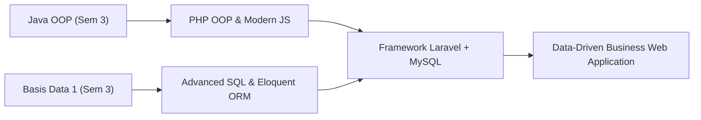

# 🚀 Rencana Belajar 4 Bulan: Data-Driven Fullstack Developer
**Target:** Mahasiswa Sistem Informasi (Transisi Semester 3 ke Semester 4)  
**Fokus Utama:** Coding & Aplikasi Berjalan (PHP Laravel + JavaScript) × Pengolahan Data & Angka Bisnis (MySQL + Analytics)

---

## 🎯 Visi & Profil Kompetensi

Sebagai mahasiswa Sistem Informasi yang menyukai **coding** dan **angka bisnis**, kamu memiliki posisi tawar unik:
* **Bukan sekadar coder biasa:** Kamu paham proses bisnis, struktur data, dan metrik keuangan di balik aplikasi.
* **Bukan sekadar analis data biasa:** Kamu bisa membuat sistem nyata yang mengumpulkan, memvalidasi, dan menampilkan data tersebut secara otomatis ke pengguna bisnis.



---

## 📅 Roadmap 4 Bulan (Minggu demi Minggu)

### 🗓️ BULAN 1: Fondasi Web Modern & Jembatan dari Java/OOP
*Tujuan: Memahami cara kerja web, mentransfer logika OOP dari Java ke PHP, dan memahami JavaScript untuk interaktivitas.*

* **Minggu 1: Transisi Logika OOP (Java ➔ PHP 8+)**
  * Konsep Class, Object, Constructor, Encapsulation, dan Inheritance di PHP.
  * Perbedaan eksekusi: Java (Kompilasi ke Bytecode) vs PHP (Server-side interpreted per HTTP request).
  * Menyiapkan environment: Laragon / XAMPP, Composer, dan VS Code.
* **Minggu 2: JavaScript Modern & Manipulasi Halaman (DOM)**
  * Variabel modern (`let`, `const`), Arrow Functions, Template Literals.
  * DOM Manipulation: Mengambil input pengguna, event listener (klik, submit, change).
  * Fetch API / Asynchronous JS: Cara mengambil data tanpa reload halaman.
* **Minggu 3: Menghubungkan PHP ke MySQL (PDO / Native)**
  * Melakukan koneksi PHP ke MySQL menggunakan PDO (*PHP Data Objects*).
  * Membuat fitur CRUD (Create, Read, Update, Delete) pertama.
  * Belajar *Prepared Statements* untuk mencegah serangan *SQL Injection*.
* **Minggu 4: Mini Latihan Bulan 1**
  * **Target Mini-Proyek:** Membuat web pencatatan stok barang sederhana (Form input barang, tabel daftar barang dari MySQL, tombol hapus/edit dengan konfirmasi JavaScript).

---

### 🗓️ BULAN 2: Penguasaan Framework Laravel & Pemodelan Data
*Tujuan: Memahami arsitektur MVC (Model-View-Controller) industri dan mengelola relasi database kompleks.*

* **Minggu 5: Pengenalan Arsitektur Laravel & Routing**
  * Struktur folder Laravel, Composer dependencies, dan file konfigurasi `.env`.
  * Konsep MVC: Bagaimana Route mengarahkan request ke Controller, Controller memanggil Model, dan mengembalikan Blade View.
* **Minggu 6: Database Migration & Seeder**
  * Membuat struktur tabel database langsung dari kode (Migration) tanpa perlu utak-atik phpMyAdmin manual.
  * Membuat data dummy transaksi otomatis menggunakan Factory & Faker untuk bahan latihan analitik.
* **Minggu 7: Eloquent ORM & Relasi Database**
  * Hubungan antar-tabel: *One to Many* (Kategori ➔ Produk, Pelanggan ➔ Transaksi) dan *Many to Many* (Transaksi ➔ Detail Transaksi ➔ Produk).
  * Query dasar dengan Eloquent: `where`, `with` (Eager Loading), dan `join`.
* **Minggu 8: Validasi Form, Auth, & Middleware**
  * Sistem login multi-role sederhana (Admin/Kasir vs Manajer).
  * Validasi input formulir (mencegah input harga minus, stok kosong, atau format salah).

---

### 🗓️ BULAN 3: Sisi Data, Angka Bisnis, & Visualisasi Interaktif
*Tujuan: Mengintegrasikan minat angka bisnis ke dalam kode web dan visualisasi data yang dinamis.*

* **Minggu 9: SQL Analitik Lanjutan di MySQL**
  * Belajar query agregasi bertingkat: `COUNT`, `SUM`, `AVG`, `GROUP BY`, `HAVING`.
  * Subquery dan CTE (*Common Table Expressions*).
  * Mengenal *Views* dan *Stored Procedure* di MySQL untuk perhitungan laporan periodik.
* **Minggu 10: Pemodelan Metrik Bisnis Riil**
  * Mengonversi rumus bisnis ke dalam query/kode:
    * **Gross Revenue** (Total Pendapatan).
    * **COGS / HPP** (Harga Pokok Penjualan) & **Gross Profit** (Laba Kotor).
    * **Month-over-Month (MoM) Growth** (Pertumbuhan transaksi dari bulan lalu ke bulan ini).
    * **Low-Stock Alert Logic** (Menandai barang yang perputarannya cepat tapi stok menipis).
* **Minggu 11: RESTful API & Integrasi JavaScript**
  * Membuat Controller di Laravel yang mengembalikan format JSON berisi data metrik bisnis.
  * JavaScript Fetch untuk mengambil data metrik tersebut di latar belakang secara asinkron.
* **Minggu 12: Visualisasi Data Interaktif dengan Chart.js**
  * Menghubungkan data dari Laravel ke library visualisasi (Chart.js / ApexCharts).
  * Membuat diagram batang (Bar Chart) tren omzet bulanan dan diagram donat (Doughnut Chart) proporsi kategori terlaris.

---

### 🗓️ BULAN 4: Capstone Project & Integrasi Mata Kuliah Semester 4
*Tujuan: Menyelesaikan 1 portofolio utuh yang sekaligus memenuhi standar semua mata kuliah semester 4.*

* **Minggu 13: Perancangan Sistem & Arsitektur (Menyelaraskan ADS 2 / RPL)**
  * Membuat Use Case Diagram, Activity Diagram, dan Class Diagram untuk sistem yang dibangun.
  * Merancang alur proses bisnis kasir hingga laporan keuangan pemilik toko.
* **Minggu 14: Eksekusi Capstone: Modul Transaksi & Operasional**
  * Membangun halaman Point of Sales (POS) kasir: Keranjang belanja, hitung kembalian, cetak struk/invoice ringkas.
  * Transaksi database (`DB::transaction`) agar jika proses simpan gagal di tengah jalan, stok tidak berantakan (prinsip ACID).
* **Minggu 15: Eksekusi Capstone: Executive Analytics Dashboard**
  * Halaman dashboard khusus pimpinan dengan kartu metrik ringkasan (KPI Cards) dan grafik tren penjualan.
  * Fitur filter rentang tanggal (misal: "Laporan 30 Hari Terakhir" atau "Laporan Kuartal Ini").
  * Fitur ekspor laporan ke format PDF / Excel.
* **Minggu 16: Polishing, Refactoring, & Dokumentasi Git**
  * Merapikan kode dan membersihkan query yang boros (*N+1 Query Problem*).
  * Mengunggah proyek ke GitHub dengan `README.md` profesional berisi screenshot dan penjelasan arsitektur sistem.

---

## 🏆 Spesifikasi Capstone Project: "RetailIQ"
*(Mini Enterprise ERP & Executive Analytics System)*

Aplikasi ini menjadi bukti portofolio bahwa kamu menguasai **coding** sekaligus **analisis data bisnis**:

```
+--------------------------------------------------------------------------+
|  RetailIQ - Executive Dashboard                                   [Admin]|
+--------------------------------------------------------------------------+
|  [KPI CARDS]                                                             |
|  Total Revenue: Rp 124.500.000  |  Gross Profit: Rp 38.200.000 (+12% MoM)|
|  Total Transaksi: 1.420         |  Stok Menipis: 4 Produk                |
+--------------------------------------------------------------------------+
|  [CHARTS SECTION]                                                        |
|  Tren Penjualan Harian (Line)    |  Top 5 Produk Terlaris (Bar)          |
|  -----------------------------   |  ---------------------------          |
|  [ Grafis Dinamis Chart.js ]     |  1. Kopi Susu Aren (420 cup)          |
|                                  |  2. Croissant Butter (310 pcs)        |
+--------------------------------------------------------------------------+
|  [MODUL OPERASIONAL]             |  [MODUL ANALITIK & EXPORT]            |
|  - Kasir POS & Transaksi         |  - Filter Tanggal Kustom              |
|  - Manajemen Produk & Supplier   |  - Laporan Laba Rugi (Export PDF/XLS) |
+--------------------------------------------------------------------------+
```

---

## 🤝 Strategi Menyelaraskan dengan Kuliah Semester 4 Lainnya

Agar seluruh mata kuliah semester 4 kamu mendapat nilai maksimal tanpa terbebani:

| Mata Kuliah Sem 4 | Cara Mengintegrasikan dengan Rencana Belajar Ini |
| :--- | :--- |
| **Pemrograman Web (Laravel & JS)** | Gunakan proyek ini langsung sebagai acuan atau tugas akhir mata kuliah. |
| **Basis Data 2 / Lanjut** | Manfaatkan skema database proyek ini untuk eksperimen Stored Procedure, Triggers, Views, dan Indexing. |
| **Rekayasa Perangkat Lunak (RPL) / MPSI** | Jadikan proyek ini studi kasus tugas kelompok: buat dokumen SRS, backlog Scrum (Jira/Trello), dan timeline rilis. |
| **Manajemen Proses Bisnis (BPM / MSI Lanjut)** | Gambarkan alur transaksi kasir hingga laporan manajer menggunakan diagram BPMN 2.0. |
| **UI/UX (Lanjutan IMK)** | Desain antarmuka dashboard di Figma sebelum kamu koding dengan CSS/Bootstrap/Tailwind. |

---

## 📌 Checklist Evaluasi Tiap Akhir Bulan

- [ ] **Bulan 1:** Mampu membuat form web PHP + MySQL yang tervalidasi dan dinamis dengan JavaScript.
- [ ] **Bulan 2:** Mampu membuat aplikasi CRUD berbasis Laravel dengan relasi tabel Eloquent yang rapi.
- [ ] **Bulan 3:** Mampu menulis query SQL untuk menghitung KPI bisnis dan merendernya ke grafik Chart.js.
- [ ] **Bulan 4:** Capstone Project selesai, berjalan lancar, terdokumentasi di GitHub, dan siap dipamerkan di CV/LinkedIn.

